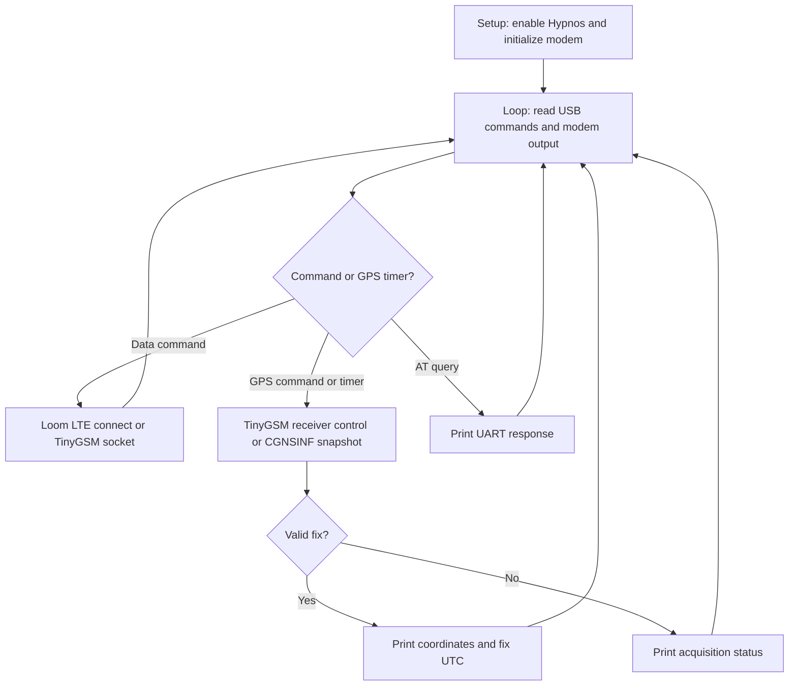

# SIM7090G console with Feather M0 and Hypnos

This example targets a **MIKROE LTE IoT 14 Click, MIKROE-6389**, containing the
SIM7090G. It selects `LTE_MODEM::SIM7090` in Loom and uses the already-installed
TinyGSM 0.12.0 `TinyGsmSim7080` driver. TinyGSM shares this driver between the
SIM7070, SIM7080 and SIM7090 families. There is one modem object and one socket
client, both owned by Loom, so the console and Loom networking share UART state.

## Wiring

Power off while wiring. Set the Click **JP1 VCC SEL to 3V3 (left)** and
**SW1 USB BOOT to 0 (right)**. JP1 selects the host logic supply, independently
of the modem's regulated supply. The board already translates host UART levels.

Use these five wires for the initial USB-powered Feather/Hypnos bench setup:

| Feather M0 / supply | Click connection | mikroBUS pin | Purpose |
| --- | --- | --- | --- |
| USB pin, USB 5 V | 5V | 10 | Main input to the Click's modem regulator |
| 3V / regulated 3.3 V | 3.3V | 7 | Host side of the level translators, with VCC SEL at 3V3 |
| GND | GND | 8 or 9 | Common reference |
| TX / D1, Serial1 TX | RX, module UART RX | 13, mikroBUS TX position | Commands into modem |
| RX / D0, Serial1 RX | TX, module UART TX | 14, mikroBUS RX position | Replies from modem |

The pin numbers are the mikroBUS positions in the supplied PDF, not SIM7090 chip
pad numbers. The PDF's middle TX/RX labels describe the host socket; the outside
TX/RX labels describe the modem. Connect host TX to modem RX.

The Click's USB-C connector is documented for power and data. It may be used as
the board's 5 V source instead of the first wire. Keep the 3.3 V logic supply and
common ground connected. Use one 5 V source at a time, avoiding backfeeding
between the Feather USB rail and a separately powered Click USB-C port. Feeding
the Click's 3.3V header alone is not the bench wiring specified here: the schematic
feeds the modem's 3.8 V regulator from the 5 V net. Do not connect 5 V to the
Feather's 3V pin or UART pins. Do not use an unverified Hypnos boost output as the
modem supply; its available burst current depends on the assembled stack.

Leave PWR (pin 1), RST (pin 2), RTS (pin 3), CTS (pin 15), RI (pin 16), SDA and
SCL disconnected for this example. Use the Click's **PWR button**, and wait for
STAT to indicate that it is running. Loom deliberately ignores power/reset GPIOs
for this externally controlled SIM7090 profile. An optional software-controlled
power sequence can be added once that wiring is chosen. The two-wire UART
configuration sends `AT+IFC=0,0` during initialization. If a previously configured
flow-control setting prevents AT replies, disable it through the Click's USB AT
port first.

The Click's RST header is **normally HIGH, active LOW**. In schematic v100, R3
(10 kOhm) pulls RST up to VCC, and Q6/Q5 translate it to the modem's RESET_N
input. Leaving the header disconnected therefore releases reset. A GPIO-driven
reset is useful for recovery, but requires explicit SIM7090 reset support in
Loom/the console; this example currently ignores the constructor's reset pin.
Do not hold RST LOW or assume that merely connecting it enables reset handling.

Attach an LTE antenna and a GNSS antenna to their respective SMA connectors.
Set **JP2 GNSS ANT** to match the active antenna's required supply: left is
3.3 V, right is 5 V. Start with 3.3 V only if the antenna supports it. GNSS needs
sky view. Its on-board antenna bias means you should check compatibility before
attaching a passive antenna. The PDF specifies a micro-SIM interface supporting
1.8 V uSIM cards.

Hypnos uses its ordinary stack connections for I2C RTC and rail control. No
external GNSS UART or NMEA wire is needed: location is queried over the modem's
main AT UART. Keep another SARA modem disconnected from Serial1.

Hardware references: supplied **LTE_IoT_14_Click.pdf**, pages 2-4, and
[manufacturer schematic v100](https://download.mikroe.com/documents/add-on-boards/click/lte-iot-14-click/lte-iot-14-click-schematic.pdf).
The schematic shows the 5 V to 3.8 V modem regulator and JP1 host-side level
translation. Carrier registration and supply stability remain hardware checks.

## First session

Select **Loomified Feather M0** (`loom4:samd:adafruit_feather_m0`). Open
`LTE_SIM7090G_Console.ino` from this folder. It uses the installed Loom and
TinyGSM libraries; copying this sketch to an older Loom installation also requires
the corresponding Loom LTE changes. Change the constructor's APN, username and
password if needed. The default is the repository's `hologram` example APN.

Open Serial Monitor at **115200**, with **Newline** or **Both NL & CR**. Press
the Click PWR button if necessary, wait for STAT, then enter:

```text
init
info
sim
status
gps watch
```

GPS acquisition does not require a cellular data session. TinyGSM initialization
does require a readable SIM status, ready or PIN locked; for a missing SIM, raw
`AT+CGNSPWR=1` and `AT+CGNSINF` remain available for receiver exploration.
Fixes print decimal latitude, longitude and the receiver's UTC timestamp.
`gps raw` prints the full `CGNSINF` CSV, including firmware-dependent extra fields.
This is a snapshot, not an NMEA stream. A valid response can be cached by the
modem, so check fix UTC before treating it as a current location.

For data testing:

```text
gps off
apn your.provider.apn
mode m1
init
connect
status
tcp example.com 80
http example.com /
rtc sync
rtc
sample
disconnect
off
```

Choose `mode nb` if the SIM/carrier requires NB-IoT, or `mode auto` for both LTE-M
and NB-IoT. `mode` uses `CNMP=38` and `CMNB=1/2/3`; it reconfigures the radio and
can interrupt data or acquisition. Check the returned AT results on your firmware.
The verified bench HTTP sequence has GNSS stopped with `gps off`; `gps quiet`
only stops printing and leaves the receiver powered. First carrier registration
can take several minutes. A failed 60-second `connect` attempt does not stop the
modem searching; leave it powered, check `status`, then retry after registration.
The APN command copies credentials into Loom-owned buffers in RAM, and clears
username/password. Provider credentials needing authentication belong in the
constructor. The mode command can persist modem settings according to its firmware.

`off` waits for SIMCom's `NORMAL POWER DOWN` response. Resume using the physical
PWR button followed by `init`; the sketch does not switch the external 5 V supply.
GPS starts only on request, and full shutdown attempts to stop the owned receiver.
The console stays awake, with SD logging disabled. Hypnos RTC is not overwritten
on every boot; `rtc sync` explicitly updates it from checked cellular UTC.

## Commands

| Command | Behavior |
| --- | --- |
| `help` | Print the complete command list |
| `init` | Initialize at 115200, without carrier registration or power-pin pulses |
| `info`, `sim`, `status`, `diag` | Query identity, SIM, signal, carrier, registration, PDP, IP and diagnostics |
| `apn <name>` | Disconnect and change the APN for the next connection |
| `mode m1`, `mode nb`, `mode auto` | Select LTE-M, NB-IoT or both |
| `connect`, `disconnect` | Use Loom's TinyGSM data-session interface |
| `tcp <host> <port>` | Open and close a real TCP socket |
| `http [host] [path]` | Plain HTTP GET, port 80, up to 1024 output bytes |
| `gps on`, `gps off` | Start or stop the receiver through TinyGSM |
| `gps read`, `gps raw` | Validated fix or raw `CGNSINF` response |
| `gps watch`, `gps quiet` | Poll every 5 seconds, or stop polling while leaving the receiver powered |
| `rtc`, `rtc sync` | Read Hypnos UTC, or explicitly synchronize from cellular network time |
| `sample` | Measure/package modules and display Loom JSON |
| `off` | Request checked modem shutdown |
| `AT...` | Execute an arbitrary AT command with a 10-second host reply deadline |

Commands are case sensitive except the initial `AT`. Input is limited to 159
characters; longer lines are discarded rather than executing a partial command.
Commands run sequentially. Every AT response is printed for the raw/query commands;
TinyGSM-managed calls produce the ordinary Loom status messages instead of a
second independent AT parser. Raw AT changes can invalidate cached state. After
changing power/data/GNSS through raw AT, use `init`, then `gps on` as appropriate.

The `connect` command uses one Loom attempt and a 60-second registration wait.
TinyGSM's internal PDP activation, socket operations, and disconnect routines have
their own blocking waits, so the total is longer and can reach several minutes
on failure. Serial commands and GPS watch pause during those calls. HTTP's 15-second
output window begins after socket connection; it is not an overall TCP deadline.
This example exercises plain TCP/HTTP; TLS certificate setup, SMS workflows and
deployment sleep scheduling are outside the example. Arbitrary AT commands remain
available for the other firmware functions.

## Code and control flow



`assembly.json` contains exact unique source excerpts for declarations, calls,
branches, helpers and delegated implementations, with feature assessments.
Baseline examples are `../LTE_with_Hypnos/LTE_with_Hypnos.ino` for initialization
order and `../LTE_GNSS_Optional/LTE_GNSS_Optional.ino` for the existing fix interface.
The ordinary R4/R5 defaults are retained. The SIM7090 adapter also verifies packet
attachment and an application IP after activation, because the installed TinyGSM
driver can treat its DEACTIVE response match as a true result. It supplies its own
shutdown and GNSS behavior instead of sending SARA-specific AT commands.

## Validation

`test_sim70xx_gnss` and the existing `test_gnss_utils` host boundary programs pass.
The SIM test checks signed coordinates, leap dates, missing/no-fix fields, malformed
numbers, geographic limits and unchanged output on rejected replies. Parsing uses
TinyGSM's raw GPS transaction and accepts varying trailing field counts.

Host GCC syntax checks against the real installed Arduino, Loom and TinyGSM headers
pass for the console, all three modem adapters, LTE dispatch/GNSS implementations,
and the existing SARA GNSS example. This uses `-fsyntax-only -fpermissive` on a
64-bit host to accommodate SDK pointer casts; it does not validate ARM ABI or linking.

Full ARM compilation and linking pass with Arduino CLI 1.5.1, the installed
Loomified Feather M0 core 4.9, and its ARM GCC 7.2.1 toolchain, using
`loom4:samd:adafruit_feather_m0:usbstack=arduino,debug=off`:

| Example | Flash bytes | Available flash |
| --- | ---: | ---: |
| `LTE_SIM7090G_Console` | 141076 | 53% used |
| `LTE_with_Hypnos` (SARA-R4) | 127380 | 48% used |
| `LTE_GNSS_Optional` (SARA-R5, default GNSS-disabled settings) | 129540 | 49% used |

The earlier **Illegal System DLL Relocation** error occurs when starting the
installed ARM compiler inside the Codex sandbox. Running the build outside that
sandbox resolves the startup failure. The console's two UTC buffers accommodate
the formatter's full integer ranges; its timestamp truncation warnings are fixed.
Existing core/dependency warnings remain.

All 31 `assembly.json` source anchors match unique excerpts at their recorded
lines. The library-discovery include-order check passes for 129 sketches. The
separate repository-wide warning-scope check fails at the existing
`src/Diagnostics/Loom_TraceSketch.h:28` include of `Loom_TraceHeapLink.h`; that
diagnostics issue is outside the LTE changes.

On 2026-11-17 the console was uploaded to the connected Loomified Feather M0;
the bootloader reported successful flash verification. The running USB console
accepted commands on COM29. Initial modem silence cleared after the Click was
turned on with its PWR button and `init` was run.

| Live bench check | Observed result |
| --- | --- |
| UART / identity | AT communication at 115200; firmware `1951B04SIM7090` |
| SIM | `CPIN: READY` |
| Hologram data | Registered roaming on Verizon LTE-M, band 13; packet attachment and application IPv4 assigned |
| Signal after moving LTE antenna by window | CSQ 15-16 |
| TCP / HTTP with GNSS off | Numeric-IP HTTP returned 301; `http example.com /` returned 200 OK and response body |
| Hypnos RTC | Read passed; cellular network UTC synchronization passed |
| Loom packaging | JSON packet printed with live RSSI and RTC timestamp |
| GNSS | Start/stop and raw status queries respond; another five-minute standalone run with `CFUN=0`, `CGNSPWR=1` and the existing antenna by a window produced no valid fix |

DNS testing explicitly selected application PDP index 0 with
`AT+CDNSPDPID=0`. Initial socket attempts with GNSS running failed; after GNSS
was stopped, raw TCP and the TinyGSM HTTP commands succeeded. Concurrent GNSS
and socket traffic have not been verified. Raw coordinates without a valid fix
flag and UTC were correctly rejected by `gps read`.

Runtime heap/stack margins, long-duration operation and supply behavior during
transmit bursts remain unmeasured. GNSS acquisition needs further sky-view testing.
The existing antenna was previously used for SARA cellular service and has no
verified GNSS specification. A known active SMA GPS antenna rated for 3.3 V,
such as [Adafruit 960](https://www.adafruit.com/product/960) (specified 3-5 V),
is a suitable replacement for a controlled acquisition test. Keep JP2 at 3V3
for that antenna. No failure of the receiver itself has been established.
