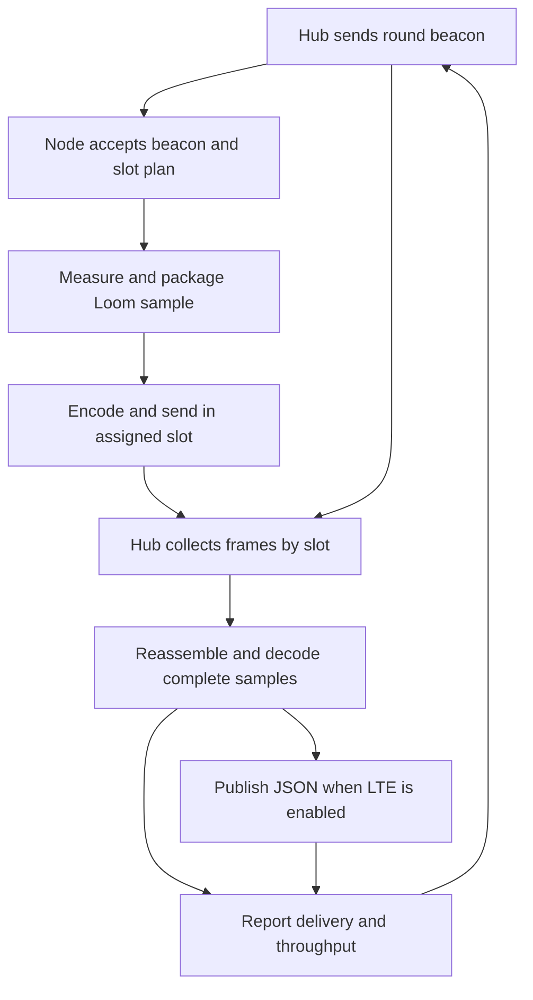

# RFM95 LoRa-to-LTE benchmark

The hub runs a scheduled single-hop network. It broadcasts a round number and slot plan. Nodes 1 through 16 each get one slot and send one Loom sample, in one or more frames. When the slots close, the hub reconstructs the samples as JSON and can publish them over LTE. The next beacon waits for that upload phase to finish, so modem stalls show up in wall-clock throughput.

## Flash and run

1. Open `LoRa_BenchmarkHub/LoRa_BenchmarkHub.ino` and flash the hub. The default is two nodes and LoRa-only timing. Use the RFM95 wiring from this Loom checkout, with SPI, CS on D8, DIO0/IRQ on D3, and reset on D4. Check the pin mapping if your carrier differs. Both sketches use 915 MHz, SF7, 125 kHz bandwidth, CR4/5 and 5 dBm by default. Match the settings in both copies of `BenchRadio.h`. Use a shielded or conducted setup for sustained throughput tests.
2. Open `LoRa_BenchmarkNode/LoRa_BenchmarkNode.ino` and flash a different `NodeId` to each node, starting with 1 and 2. The node sketch initially sends synthetic temperature and humidity. To run a real sensor, declare its Loom module next to `Manager manager`, enable its board rail before `manager.initialize()` if required, and set `SyntheticData` to false. The node sends the whole packaged document, including identity and packet number.
3. Open the hub and node serial monitors at 115200 baud. Reset the hub with its monitor open to capture the first reconstructed sample. The hub prints cumulative delivery and throughput every 10 seconds. Repeat at 2, 4, 8 and 16 physical nodes by changing the first field of the hub's `Plan` and flashing additional node IDs. Raising the configured count alone reserves empty slots.
4. To test LTE, copy `arduino_secrets.example.h` to `arduino_secrets.h` in the hub folder, fill in the APN and MQTT broker settings, and set `BENCH_ENABLE_LTE` to 1 in the hub sketch. The template selects the OPEnS Jolteon SARA-R5 example wiring with A5 PWR_ON and D6 supply enable. Adjust the profile and supply pin for your board. The default MQTT topic is `lora-bench/LoRaNode1` for node 1, and similarly for other nodes. MQTT acknowledgment is counted separately from radio delivery.

## Sweep packet size and rate

- **JSON versus MessagePack.** Both node modes measure and print `json_B` and `msgpack_B` for the same document. `SendJson = true` sends text for the baseline. The default sends MessagePack, which encodes numbers and structure in binary and preserves field names. The hub publishes ordinary Loom JSON in both cases. Compare both modes with the same sensors, node count, and radio settings.
- **Tune the slot.** `Plan` holds the node count, bytes per fragment, maximum fragments per slot, and preparation time in milliseconds. Start with the default 245 bytes and one fragment. Then reduce the second field to just above the largest reported encoded size and repeat. Vary `PaddingBytes` to sweep payload size. If a real packet needs more room, raise the fragment count, up to eight within the hub's 8 KiB receive-buffer limit. The on-wire body can reach 1,960 bytes when the plan permits it. Loom's JSON memory pool and MQTT JSON size limit also apply. A node reports `oversize` or `slot budget` if the packet does not fit. Increase the fourth field for slow sensors. The hub advertises the new plan, so changing the plan only requires reflashing the hub.
- **Compare radio profiles.** Use `WideBandwidth = true` in both copies of `BenchRadio.h` to test 500 kHz at SF7, then reflash every radio. Run both profiles at the distance or signal level of interest. Compare the fastest settings that meet your delivery target.
- **Read the counters.** `LoRa_samples/s` and `LoRa_payload_B/s` use only the beacon and receive rounds. Payload bytes count the encoded document and exclude frame headers. `wall_samples/s` includes JSON parsing, serial reporting, configured idle time, and LTE work. `mqtt_ack/s` counts broker-acknowledged publishes across wall time. Each node's `missed` includes partial frames and invalid documents, which are also listed separately. A silent node, duplicate ID, or missed beacon can reduce delivery. Node `sent` means TX completed locally.
- **Benchmark scope.** The sketches use no LoRa acknowledgments or retransmissions. The hub buffers one round in RAM. After a publish failure it counts that reading and any remaining readings in the round as unacknowledged, and it tries publishing again on the next round. Sample capture time remains the node's responsibility when adding real sensors.

For one full 245-byte body per node with the default 125 kHz profile, the calculated slot is 434 ms and the beacon takes about 47 ms. With the default 120 ms preparation lead, the modeled ceiling is about 1.9 samples/s for two nodes and 2.25 samples/s aggregate for sixteen. These estimates use a full slot per node and exclude processing, serial, LTE and loss.

A host simulation with ArduinoJson and simulated radio and MQTT interfaces checked all 16 receive slots, both encodings, fragment loss, wrong-slot frames, oversized samples and publish failure. The Windows ARM compiler stopped at launch with a DLL relocation error. Board compilation and live RF and LTE tests remain pending.

## Sketch flow

### sourceLinks

| Nodes | Sketch source anchor | Delegated behavior |
| --- | --- | --- |
| Setup | Hub `ready = beginRadio(radio, HubAddress);` and node `ready = beginRadio(radio, NodeId);` | `BenchRadio.h` configures RadioHead using the D8/D3/D4 mapping declared in [Loom_LoRa.h](../../../src/Radio/Loom_LoRa/Loom_LoRa.h). |
| H0 | Hub `if (sendFrame(radio, beacon, sizeof(beacon)))` | `BenchRadio.h` calls `radio.send(frame, len)` and waits for TX completion in the installed RadioHead driver. |
| N0 | Node `const Schedule schedule{frame[4], frame[5], frame[6], read16(frame + 7)};` | `Schedule::valid()` checks the advertised bounds. |
| N1 | Node `manager.measure();` and `manager.package();` | [Manager implementation](../../../src/Loom_Manager.cpp) dispatches registered modules and creates the Loom packet with `doc["id"]["instance"] = get_instance_num();`. |
| N2 | Node `if (!sendFrame(radio, frame, frameBytes))` | `BenchRadio.h` derives the timing from `airtimeMs()`. The [existing Loom sender](../../../src/Radio/Loom_LoRa/Loom_LoRa.cpp) also uses MessagePack. Its standard data path selects `static_cast<uint8_t>(sizeof(buffer))` as the transmitted length. |
| H1 | Hub `receiveRound(round, millis());` | The installed RadioHead driver's `RH_RF95::recv()` gives the received length, with the sender available through `headerFrom()`. |
| H2 | Hub `memcpy(payloads[node - 1] + packet.bytes, frame + HeaderBytes, body);` and `deserializeMsgPack(sample, encoded, packet.bytes);` | The hub checks fragment order and only processes complete payloads. ArduinoJson reconstructs the document. |
| H3 | Hub `canPublish = mqtt.publish();` | [Existing LoRa-to-LTE example](../../Lab%20Examples/LoRa_To_4G/LoRa_To_4G.ino) uses the same Loom LTE/MQTT pair. [Loom_MongoDB::publish](../../../src/Internet/Logging/Loom_MongoDB/Loom_MongoDB.cpp) calls `publishDocument(topic, manInst->getDocument())`. [MQTTComponent](../../../src/Internet/Logging/MQTTComponent/MQTTComponent.cpp) streams JSON and calls `finishPublish()`. |
| H4 | Hub `Serial.print(F(" wall_samples/s="));` | `report()` uses measured round and wall time for separate rates. |

The edge IDs follow diagram order. `0` carries the beacon. `1` starts measurement after validation. `2` passes the packaged document to the encoder. `3` carries data frames. `4` opens the receive round after beacon TX. `5` passes the buffered fragments to `processRound()`. `6` publishes eligible samples. `7` and `8` feed the counters. `9` returns to the next round.

### featureAssessments

| requestId | Status | Scope |
| --- | --- | --- |
| `$brief` | partial | Scheduled RFM95 collection, payload comparison, and an LTE upload path are implemented. Measured RF and LTE rates require the bench hardware. |
| `schedule` | supported | Hub beacons coordinate 2 to 16 nodes without RTC synchronization. |
| `sensorPayload` | supported | ArduinoJson MessagePack and JSON modes accept the Loom document within the configured slot and document budgets. |
| `lteUpload` | needs-info | Live upload needs the hub's modem settings, SIM/APN, broker and credentials. |
| `simultaneousChannels` | unsupported | One RFM95 can tune to different frequencies, with one receive configuration at a time. Concurrent channel reception calls for a gateway concentrator such as the SX1302. |
| `meshRouting` | partial | Scheduled star mode is implemented. RadioHead RHMesh is a candidate for multi-hop route discovery if nodes cannot reach the hub directly. This bench measures the direct links. |
