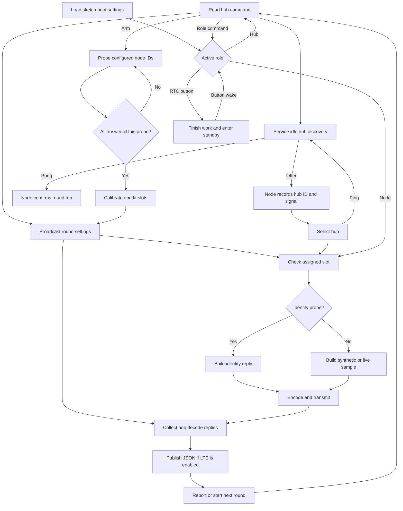

# RFM95 LoRa-to-LTE benchmark

Both sketches run the same firmware with different boot roles. The Hub sketch starts as idle hub 1 and advertises. The Node sketch starts with its configured `Boot` ID and listens for hub 1 by default. A node can hear either an idle offer or a live test beacon and reply in its assigned slot. The hub broadcasts each run's settings and collects the results. LTE uploads happen after the radio slots close.

## First run

1. Flash the [Hub sketch](LoRa_BenchmarkHub/LoRa_BenchmarkHub.ino) and the [Node sketch](LoRa_BenchmarkNode/LoRa_BenchmarkNode.ino) for the roles you want at boot. The Loom RFM95 wiring uses SPI, D8 for CS, D3 for DIO0/IRQ, and D4 for reset. The default RF profile is 915 MHz, SF7, 125 kHz, CR4/5 and 5 dBm. Use a shielded or conducted setup for sustained throughput tests.
2. Open the serial monitor at **115200 baud** with **Newline** or **Both NL & CR**. One Hub plus one Node can communicate with the defaults. For additional nodes, assign unique IDs with `id 2`, `id 3`, and so on. The node ID is the Loom device instance, radio address, and slot number.
3. On the hub, use `set nodes 2` for IDs 1 and 2, then `arm 10`. Power the nodes up in any order. The hub waits for the configured IDs, samples their packet sizes, fits the slots automatically, and prints the results after ten measured rounds. For a single node, set `nodes` to 1 first.
4. Use `run 10` for an immediate test with the configured slots, or `start` for live collection with automatic slot fitting. Use `stats` to see current results and `sample 1` to inspect the last received sample from node 1.

## Dendrometer bench with one hub and two nodes

Flash the Hub sketch to the hub and the Node sketch to both dendrometers. Give the nodes Loom IDs **1 and 2** in `Boot`, or use `id 2` on the second node after flashing. On the hub, the default two slots already cover those IDs. To compare a radio-only synthetic baseline with live sensor traffic, run these commands in order, waiting for the first run to finish before changing its settings.

```text
set source synthetic
arm 10
set source sensors
arm 10
sample 1
sample 2
```

The live packet carries **SHT31** temperature and relative humidity and **AS5311** position, magnetic field, alignment, and displacement in µm. The profile follows the existing Dendrometer sketch with SHT31 at I²C `0x44` and AS5311 CS/CLK/DOUT on `A3/A5/A4`. The synthetic payload contains only the simulated benchmark fields and packet metadata. Synthetic and readiness-probe rounds skip the hardware sensor reads.

If a live sample has missing AS5311 fields, run `encoder` over USB serial on the idle node. It shows the position and magnitude words and flags constant data, unfinished offset compensation (`OCF=0`), overflow (`COF=1`), a linearity alarm (`LIN=1`), or a parity error when the conversion is otherwise ready. This command leaves the displacement baseline alone.

Radio-only builds enable the dendrometer profile by default. LTE builds leave it off because the AS5311 clock and LTE power control share A5. The hub can receive dendrometer data with or without LTE enabled. For unrelated hardware, define `BENCH_ENABLE_DENDROMETER 0` before including the shared benchmark header.

For multiple hubs, assign each a unique ID with `set hub <id>`. Nodes give their configured preferred hub a five-second head start and then can join another heard hub. A node keeps its automatic selection until two minutes without contact, then searches again. Use `hub <id>` on a node to pin it to a particular hub or `hub auto` to resume discovery.

## Drop-in node IDs

The default bench remains one hub and two fixed-ID slots. For automatic enrollment, flash the updated firmware to the hub and every participating node. The hub gives a node its preferred device number if that slot is free, or the first free slot in `1..nodes` if there is a conflict. For example, two boards that both prefer ID 1 can join as IDs 1 and 2. The assigned number is the node's radio address, slot, and packet instance.

- **From serial:** On the idle hub, set its capacity with `set nodes 2` and enable `set enrollment on`. On each node, optionally set a label such as `name NorthDendro` and a preference with `id 1`, then enter `id auto`. Use hub `leases` and node `status` to see the reservation and the resulting ID. Use `set enrollment off` on the hub and `id <number>` on each node to return to fixed mode.
- **At boot:** The optional fifth and sixth `Boot` arguments enable enrollment and set the Manager name. For example, use `Boot{bench::Role::Hub, 0, 1, 1, true, "BenchHub"}` on the hub and `Boot{bench::Role::Node, 0, 1, 1, true, "NorthDendro"}` on a node. A preferred ID of 0 uses the node Manager's configured device number. Use firmware defaults if a node must rejoin automatically after a power cycle; serial settings last until reset.

Give devices distinct Manager names for easy identification in logs. The hub keys slot reservations by a 64-bit fingerprint of the Feather hardware serial, so duplicate or changed names do not move reservations. Reservations live in hub RAM and survive a **node** reboot while the hub is powered. A hub reboot clears the table and nodes join again. Slots are not reused merely because a node goes offline. On an idle hub, use `set forget <slot>` after taking a board out of service to free its reservation.

Enrollment uses a separate beacon format and short join windows between rounds. Fixed-ID and automatic nodes do not share one hub schedule. In automatic mode, the beacon is larger and join windows add wall-clock time; use fixed mode for comparison with the original throughput baseline. This is direct hub-to-node enrollment. Relay forwarding and automatic renumbering of multiple hubs are not implemented.

## Switch roles

On either sketch, enter `role hub` or `role node`. Enter `role` to show the active role. Commands take effect between rounds. Leaving hub mode ends its current run and prints the results. Each board retains its hub settings, node ID, and hub selection mode while powered. To set the reset defaults, edit `Boot` in that sketch in the order role, preferred device number, hub ID, preferred hub, optional enrollment flag, optional Manager name.

Only one role runs at a time. A board with an LTE modem can upload in hub mode when the build includes LTE. If already initialized, its LTE session stays available across a role switch.

## RTC button standby

On the Loomified Feather M0, both sketches use the active-low RTC interrupt line on **D12** as the sleep/wake button. Press and release to request standby. A hub finishes its current round or upload, prints the results, and stops the run before sleeping. A node finishes its current slot. Press again to wake. After releasing the wake button, another press can put the board back to sleep.

Standby puts the SAMD21 and RFM95 into sleep and powers down initialized Loom node modules through their drivers. The dendrometer profile also switches off its Hypnos rails on D5/D6 and restores them on wake. If LTE was started, the benchmark turns off the modem supply pin it enabled after confirmed modem shutdown. The benchmark uses D12 as its button input and does not program DS3231 alarms. The shared line must return high after release. The older Dendrometer example uses a separate button on A1, which can be selected with `BENCH_RTC_BUTTON_PIN A1` on that wiring.

After wake the board keeps its role and IDs. A hub resumes advertising and is ready for a fresh run. A node listens for the next beacon. USB serial re-enumerates, so reopen the monitor if needed. Run `set lte on` to enable uploads again. If a module fails to confirm shutdown, the board stays awake. To change the pin or disable the button, define `BENCH_RTC_BUTTON_PIN` before including the shared benchmark header. Use `-1` to disable it.

## Hub commands

| Command | What it does |
| --- | --- |
| `help`, `status` | Show commands, radio readiness, and current settings. |
| `set hub 1–16`, `set offer on\|off` | Set this hub's ID and control idle advertisements. Defaults 1 and on. Change these while idle. |
| `scan [rounds]` | Probe node IDs 1 through 20 using LoRa only. Nodes must have selected this hub. Default 2 rounds. |
| `arm [rounds]` | Wait for all configured IDs, calibrate packet size, fit the shortest shared slot with 16 B of headroom, then run the requested measured rounds. Default 10. Use `stop` to cancel. |
| `run [rounds]` | Run a fixed number of attempts and print a final report. Default 10. |
| `compare [rounds]` | Run MessagePack then JSON and print a separate report for each. Default 10 attempts per format. Both use the same slot settings. |
| `fit [headroom_B]` | Use the largest sample from the last matching run to set the shortest shared slot. Adds 16 bytes of headroom by default. Every configured node must have delivered a sample. |
| `start`, `stop` | Start live collection or stop after the current round. Automatic slot fitting applies in unpaced mode. A slow LTE call can delay `stop`. |
| `stats`, `sample [id]` | Show current or last-run totals. Show a decoded sample from the last received round, with an optional node ID. Save the serial output to keep both legs of a comparison. |
| `set nodes 1–20` | Set the number of consecutive slots. Default 2. |
| `set chunk 1–245`, `set fragments 1–8` | Set bytes per fragment and maximum fragments per slot. Defaults 245 and 1. The product of node count, chunk size, and fragment count must fit in 8,192 bytes. |
| `set lead 12–10000`, `set gap 0–60000` | Set preparation time after the beacon and idle time between rounds in ms. Defaults 120 and 0. Increase lead for slow sensor reads. |
| `set period <node\|all> <ms>`, `periods` | Set or show a node's fixed upload period (100 ms to 24 hours, or 0 to clear). Applies to `start`, `run` and `compare`. |
| `set pad 0–1800`, `set format msgpack\|json\|raw` | Select the wire encoding. MessagePack and JSON can add padding to vary sample size. Defaults are 0 and MessagePack. |
| `set source synthetic\|sensors` | Choose the simulated temperature/humidity payload or live Loom sensor fields. Padding is independent. Default synthetic. |
| `set retries 0–10` | Allow up to 10 additional attempts by default, after the first send. In basic mode this controls bitmap retry windows. In ACK modes it controls attempts per RF fragment. |
| `set transport basic\|ack\|radiohead` | Select bitmap recovery, a benchmark ACK for each RF fragment, or RadioHead reliable datagrams. ACK modes use `set polling slots`. |
| `set cad 0–10000`, `set acktimeout 60–1000` | Set the node data clear-channel budget and ACK timeout in milliseconds. ACK modes default to 100 ms CAD and a 500 ms ACK timeout. RadioHead randomizes its timeout between the configured value and twice that value. |
| `utc <Unix UTC seconds> <rounds>`, `utc stop` | Start or stop an autonomous schedule on a Feather M0 with a synchronized DS3231 and fixed node IDs. Enter the same future start and round count on all participants. |
| `utc sd\|ram <epoch> <rounds> [ack_ms tx_dBm cycle_s trial]`, `utc status` | Use compact RadioHead readings in fixed UTC slots, with an SD backlog or a fresh reading each cycle. Use the same settings on the hub and nodes. |
| `utc radio sd\|ram <epoch> <rounds> <ack_ms> <tx_dBm> <cycle_s> <trial> [sync]` | Arm both fixed-ID nodes from the hub over LoRa. Use a nonzero trial ID. The optional `sync` sets the nodes' RTCs from the hub. |
| `utc clock <Unix UTC seconds>` | Set and verify the RTC on an idle board. |
| `set polling slots\|individual` | Choose broadcast slots or one addressed station at a time for `run`, `start`, and `compare`. |
| `set samplewindow 0–65000`, `set sampleperiod <ms>` | Set the individual live sampling window and its cadence. A sample period of 0 opens the window before each collection pass. |
| `set lte on\|off` | Enable or disable MQTT publishing for the next test. Requires an LTE-enabled build to turn on. Default off. |

Stop a run before changing its settings.

## Node commands

| Command | What it does |
| --- | --- |
| `scan` | Listen for offers and beacons for eight seconds, then show IDs and signal quality. Scheduled transmissions pause during this manual scan. |
| `hubs` | Show the selected hub and hubs heard within the last 15 seconds. |
| `hub <1–16>` | Select a destination and clear the previous link's counters and sample. Fixed IDs stay the same; auto nodes request a slot from the new hub. |
| `hub auto` | Restore automatic hub discovery. This is the boot default. |
| `ping` | Send a directed request to the selected idle hub. A matched reply confirms both directions. A missing reply times out after one second. |
| `id <1–20>`, `id auto` | Set a fixed ID and preference, or ask the hub to assign a slot using that preference. |
| `name <label>` | Set the Manager name sent in packets. The hardware fingerprint stays the same. |
| `interval <ms>` | Set the local sensor period for paced live runs (100 ms to 24 hours, or 0 to read on request). |
| `samplebudget <ms>` | Set the maximum expected duration of a blocking local reading in individual mode. Default 350 ms. |
| `status`, `sample`, `reset`, `help` | Inspect link counters or the last sample, clear them, or list commands. |

Stop the benchmark before manually switching destinations. Discovery can hear idle offers and active test beacons. Known idle hubs answer directed pings even with advertisements disabled. The radios share airtime, so run one benchmark hub at a time per RF channel. For throughput measurements, turn off advertisements on other hubs on that channel. Hub selection tests direct links. Relaying would require a separate forwarding schedule.

## Test recipes

| Goal | Commands and comparison |
| --- | --- |
| Power up nodes at different times | Set the expected node count, then use `arm 30`. The hub reports the ready count as nodes start. Give each node a unique ID in the configured range. |
| Switch hubs and check both directions | On the node use `scan`, `hub 2`, and `ping`. On hub 2 use `scan 1` to confirm its scheduled uplink. |
| Find nodes and check identity | On the selected hub, use `scan`, then `sample 2`. Use node `status` to check IDs and beacon reception if the hub reports a miss. |
| Compare encoding sizes | `compare 20`. Compare `max_sample_B` and delivery in the two reports. On a node, `status` gives both sizes from the same sample. The fixed slot plan holds radio scheduling constant across both legs. |
| Benchmark with fitted slots | Select the source and format, then use `arm 30`. The hub automatically fits the slots before it measures. Compare delivery, raw receive throughput (`LoRa_rx_frame_B/s`), and estimated populated data (`LoRa_est_data_B/s`). For a manual trial with extra headroom, use `fit 32` followed by `run 30`. |
| Test fragmentation | `set chunk 100`, `set fragments 3`, `set pad 50`, then `compare 20`. Tune the pad or fragment budget. A node reports `oversize` or `slot budget` if it cannot send within the plan. |
| Measure LTE impact | Run `run 20` with LTE off, then `set lte on` and `run 20` again. Compare `wall_samples/s`, `mqtt_call_s`, `mqtt_ack/s`, and `mqtt_unacked`. |

`LoRa_samples/s` and `LoRa_payload_B/s` cover beacon and receive windows, including scheduled retries when enabled. Payload bytes exclude frame headers. Wall rates include decoding, serial work, inter-round gaps, and LTE calls. The `arm` probe phase is excluded from the measured run and sends no LTE uploads. `delivery_pct` counts the entire run. `first_good_round`, `expected_since_join`, and `delivery_since_join_pct` separate time before a node's first valid packet from later losses. A silent node still counts against whole-run delivery. `missed` includes partial frames and invalid documents, which are also shown separately. A failed first beacon does not add to per-node expected samples. Node `sent` means local TX completed on the first pass. A broker ACK records MQTT delivery to the broker. The hub buffers one round in RAM and stops attempting further publishes in that round after a publish failure.

`LoRa_rx_frame_B/s` includes accepted uplink fragments and their benchmark and RadioHead headers, including retry fragments, even if a sample is partial or fails to decode. It excludes beacons and physical-layer overhead. `LoRa_populated_fields/s` and `LoRa_est_data_B/s` count each valid sample only once; the matching `wall_*` rates include time outside the radio windows. Compare `populated_fields` with `expected_fields_in_good_samples` for field completeness, and use delivery to see how many samples were lost entirely.

The estimate assumes up to **19 bytes per live dendrometer sample**: temperature, humidity and displacement at four bytes each; magnetic field, raw position and averaged position at two bytes each; and alignment at one byte. The synthetic baseline counts only its two simulated values (up to **8 bytes per sample**). The estimate excludes packet metadata, padding, field names and encoding overhead. Missing or non-finite numbers, out-of-range encoder codes and alignment `Error` do not count. The hub cannot distinguish a reused SHT31 value from a fresh reading.

### Loss and long runs

Start with `set retries 0` for the raw baseline. With retries enabled, the hub holds on to received fragments and broadcasts a bitmap for only the missing fragments and nodes. Each requested node resends from its cached sample in a dedicated retry slot. A duplicate fragment cannot inflate delivered samples. A node that missed the original beacon or could not encode a sample has no data to resend. Invalid decoded documents are reported separately. Firmware can set the hub's retry limit with the optional seventh `Boot` argument.

### Compare delivery and throughput

Reflash the hub and nodes together. Open the Windows hub monitor, then run `Run-LoomCadenceComparison.ps1 -LinkMatrix -Source synthetic -NodeCount 2` for simulated samples or use `-Source sensors` for live dendrometers. Each profile defaults to 1,000 rounds, or 2,000 expected records with two nodes. The runner fits each encoding once, applies the same CAD budget to all three transports, and tests inter-round gaps of 0, 250, and 500 ms. Set `-Rounds 100` for a short checkout, `-GapsMs 0` for a single gap, or `-CadMs 10000` to try the release example's CAD budget. It saves per-profile counts and records per minute beside the monitor log. Use the existing hub `sweep` command for the SD timing sweep. The Windows link matrix writes its comparison files on the PC.

The hub reserves enough slot time for all allowed attempts. Shorter inter-round gaps leave that reservation intact. The custom transport ACKs a valid fragment, including a duplicate when its previous ACK was lost. RadioHead's manager ACKs at the datagram layer, then the hub validates the benchmark frame. In the two ACK modes, the node's `status` reports retransmission attempts, recovered fragments, and attempts on failed fragments. Divide `link_failed_attempts` by `link_failed_fragments` for the mean when a fragment fails. ACKs and hub control frames are sent immediately. The optional clear-channel wait applies to node data.

In awake slot runs with retries enabled, the two ACK modes also give each missing or incomplete record up to two directed recovery polls. A node that missed the beacon can answer a full poll. If the hub already has part of the record, the node may send only the missing fragments from the original encoded bytes. The hub's `retry_slots` counts these recovery polls or the basic mode's bitmap slots. It does not count retransmissions made by the link layer. The hub and nodes both need this firmware for recovery polling.

Raw uses a 27-byte record with a field presence mask. It carries packet number, optional sample uptime, temperature and relative humidity in hundredths, AS5311 magnitude and positions, alignment, and displacement in encoder steps. The hub reconstructs the benchmark node name from its ID. Use MessagePack for original names, extra modules, or arbitrary fields.

### UTC slots for sleeping stations

Use fixed IDs and synchronized, running DS3231 clocks on the hub and each station. Arm each board once with the same `utc <future Unix UTC seconds> <rounds>` command, allowing enough time to reach all the boards before the start. Set each station's preferred hub to the listening hub. The shared defaults in [BenchUtc.h](../../../src/Radio/Loom_LoRa/Benchmark/BenchUtc.h) are two stations, a five-minute cycle, 16-second slots, live raw data, and custom ACKs with up to 10 retries. Change the `BENCH_UTC_*` defines consistently across the sketches to compare another configuration. The command checks that the slot can contain the configured retry budget and guard times.

The station derives its slot from its fixed ID and wakes to sample before that slot. Its RFM95 sleeps between slots, and the Feather uses timed standby while waiting. It rechecks the external UTC clock after waking. The hub listens during the scheduled windows without sending a per-round poll or beacon. The schedule is kept in RAM until it finishes, stops, or resets. This mode leaves sensor rail configuration to the node firmware. Use the awake link matrix for accelerated throughput measurements, and a UTC run to check timed wake and delivery on battery-powered nodes.

### SD backlog and reliability matrix

Use `utc sd <epoch> <rounds>` on every board to save readings before sending. The node sends up to four oldest pending compact readings in a RadioHead datagram. The hub validates and saves new readings to its SD card, then sends a separate receipt. The node advances its saved cursor only after a matching receipt. If the data or receipt is lost, the same readings can be sent again in a later slot. The hub remembers the newest saved timestamp for each fixed node ID and skips already saved readings. Keep each node's SD card with its configured ID. After a reboot, arm a new future schedule with the same IDs and trial value 0 to resume the backlog.

The SD files use 8.3 names. `BQ…BIN` contains the node's measurements, `BA…BIN` contains its confirmed queue positions, and `BR…BIN` contains the hub's accepted readings. A measurement entry is a 32-bit cycle epoch, a 27-byte compact record, and a CRC-32. A cursor entry is a 32-bit byte offset and a CRC-32. Multi-byte values are little-endian. The journals retain confirmed data. Startup trims a short trailing write and reports a full-sized damaged tail as a setup error. The defaults use the Hypnos V3.3 SD chip select on D11, 24-second slots, a five-minute cycle, 23 dBm configured power, a 500 ms ACK timeout, and 10 retries per datagram.

At 24 seconds per node, the five-minute cycle can schedule 12 nodes. A 20-node queue run needs at least 480 seconds per cycle at that slot width.

Use `utc ram` for the no-SD comparison. It sends a fresh reading in the same slot schedule and uses the same RadioHead and receipt framing. Any reading still missing after that slot is counted as a loss. Both modes reserve two extra cycles at the end for recovery, with sampling turned off during those cycles. A nonzero trial ID gives each SD trial its own empty journal and keeps the stations awake between slots. Trial ID 0 uses the persistent field journal and standby between slots.

Flash the hub and both nodes with the same firmware. Leave only the hub connected by USB, with the two fixed-ID nodes powered and listening and an SD card in each board. Close any serial monitor that has the hub port open. Run this from PowerShell, substituting the hub's COM port.

```powershell
.\Run-UtcReliabilityMatrix.ps1 -HubPort COM3 -SyncClocks
```

The hub sends each node the trial settings and waits for both to confirm. Setup and statistics use the firmware's default transmit power so a low-power test can still return its counters. `-SyncClocks` explicitly sets the hub RTC from the PC and the nodes' RTCs from the hub at the start of each trial. Omit it if the clocks are already synchronized. For direct USB control of all three boards, supply `-NodePorts COM9,COM25` with their actual ports. The hub-only CSV leaves sender totals blank if either node's final report is missing.

The runner tests 100 and 500 ms ACK timeouts at 5, 14, and 23 dBm, each with SD on and off. It keeps 10 retries, two nodes, 50-second cycles, the compact encoding, and LTE off throughout. Each combination schedules 250 new readings per node, for 500 expected. Budget about 3.5 hours per combination and 42 hours for all 12 at the default cadence. The CSV records on-time delivery, backfills, final misses, and duplicates. It also sums the senders' datagrams attempted, datagrams that used at least one link retry, and total link retry attempts. One retried datagram with three attempts after its initial send adds one to `DatagramsRetried` and three to `DatagramRetryAttempts`. A later slot's SD resend counts as a new datagram. To repeat on the same cards, use an unused range of trial IDs via `-FirstTrialId`.

For a range test, keep the radio and slot settings fixed between locations. Run the simulated and sensor `arm 30` checks first, then capture the serial log during a longer run at each distance. Use `start` for a report every ten seconds and `stop` for final totals, or `run <rounds>` with the same fitted plan for controlled comparisons. Record `first_missing`, `first_partial`, `recovered`, `final_missing`, `final_partial`, and `final_invalid` along with the per-node RSSI/SNR and sample totals. Report first-pass and final delivery separately; `retry_radio_s` shows the time that recovery added. Compare a retries-off run and a run with `set retries 2` at each distance before choosing a retry budget.

### Paced benchmarks

For five-minute dendrometer sampling, use `set nodes <count>`, `set source sensors` and `arm 30`. After it finishes, use `fit`, `set period all 300000` and `start`. `fit` saves a slot plan for the paced run, which uses that plan without sizing polls. A separate `set period <node> <ms>` can give any node a different upload period. The source in each beacon selects simulated or live readings on the nodes. Use `run <rounds>` for a bounded test and stop a run before changing settings.

When any configured node has a nonzero period, only nodes with a period participate. Each starts due and keeps its original time grid. The hub allocates compact slots to the due nodes only. Retries do not move the next deadline; overruns skip expired deadlines instead of sending a catch-up burst. `skipped_deadlines` counts those skips separately from radio losses. The shared gap is ignored in paced runs. `set period all 0` restores the original shared-gap behavior. `arm` and `scan` do not use the configured periods.

Compare matched live runs with the same fitted slots and retry limit while changing `set period all <ms>`. Check each node's delivery, the hub's `beacon_failures` and `skipped_deadlines`, and first-pass losses before choosing a rate. `round_max_ms` measures the longest poll through retries and hub processing. `poll_finish_max_ms` includes any delay from the scheduled deadline and equals `round_max_ms` in back-to-back mode. Subtract it from 300,000 ms to estimate how much of a five-minute cycle remains after collection in that run. SD or LTE timing needs a separate measurement. Node `status` reports `slot_budget_misses`, `radio_tx_failures`, and `oversize_samples` since boot or `reset`.

The Windows cadence sweep uses the hub's configured node count, or an explicit `-NodeCount` from 1 to 20. A rate qualifies after two runs in which every configured node delivers every expected record, all seven dendrometer fields are populated, and the polls finish within the tested period with no skipped deadlines. The sweep reports the fastest qualifying rate and the qualifying rate with the fewest scheduled retry slots. Ties favor the faster rate. The five-minute budget uses the longest finish observed at the rate with the fewest retries.

The Hub sketch also enables a firmware sweep through `BENCH_ENABLE_SWEEP`. Set the configured node count while idle, then use `sweep usb 8` for an eight-hour test captured by the USB serial monitor, or `sweep start 8` to save results on the hub's SD card. `sweep status` shows progress and recommendations. `sweep stop` or `stop` saves the interruption and restores the pre-sweep settings. A sleep request or role change also stops the sweep. The nodes need their own power and the same benchmark protocol firmware. For the first USB run, leave `Monitor-LoomHub.cmd` open to save the serial output. Its `-Port <hub COM port> -SweepHours 8` options start the USB sweep after checking hub readiness and request Windows to stay awake while capturing. Add `-SweepToSD` to start SD mode through that monitor. Set `SweepHoursOnBoot` in the Hub sketch to a value from 1 through 72 to start SD sweeps automatically on power-up. Its default is 0, which starts on command.

Every profile below runs simulated and live MessagePack samples, using the existing `armRun(1)` readiness and sizing path before fitting the requested headroom. Each measured test polls every configured node 1,000 times. A clean test is repeated once for confirmation. The suite continues through the profiles to compare both delivery speed and retry cost. A positive polling allowance is added to the fitted first-pass window, including the beacon, and rounded up to 100 ms. The first-pass slot calculation and bitmap retries stay in `BenchHub.h` and `BenchNode.h`.

| Profile | Preparation ms | Packet headroom B | Retry limit | Polling allowance ms |
| --- | --- | --- | --- | --- |
| 1 | 120 | 16 | 0 | Back-to-back |
| 2 | 120 | 16 | 10 | Back-to-back |
| 3 | 120 | 16 | 10 | 500 |
| 4 | 120 | 16 | 10 | 2,000 |
| 5 | 250 | 16 | 10 | 500 |
| 6 | 500 | 32 | 10 | 500 |
| 7 | 120 | 16 | 1 | 2,000 |
| 8 | 120 | 16 | 0 | 2,000 |

SD mode creates a fresh `SW0001.CSV` and `SW0001.TXT` pair, advancing the number for later sessions. CSV contains one row per measured test. TXT contains each test's per-node statistics, timing and throughput, plus the current fastest and fewest-retry recommendations for each sample source. It uses `SDManager::writeDebugRecords()` to check, flush and close each append between tests. A failed SD append stops the sweep. Completed records survive an interrupted session. At the time limit, the hub finishes its current radio round and records the partial test, which cannot qualify. A large array may finish a subset of the profiles within the selected hours. Log timing uses board uptime. `BENCH_SD_CS_PIN` defaults to D11 for Hypnos V3.3 and can be set to D10 for V3.2. LTE uploads are disabled during the sweep.

By default, nodes read sensors on request. For an independent sampling clock, set `interval <ms>` on a node. During a paced sensor run the hub grants quiet time between polls, and the node can collect up to four readings in RAM on its own timer. Each assigned upload slot takes **one** oldest reading, with `sample_ms` recording node uptime at capture. A full queue drops its oldest reading and increments `local_dropped`. If the queue is empty, an explicit empty reply counts as successful radio delivery but not as a sensor sample. The queue is for benchmarking: it is not persistent, does not batch multiple readings into one transmission, and a reading is retained for this round's retries rather than held for an end-to-end acknowledgement. Synthetic runs do not use the local sampler.

## Individual polling

Use `set polling individual` on the hub. It visits enrolled stations in ascending ID order, or configured IDs 1 through `nodes` in fixed-ID mode. Each unicast request has one response window. The hub checks the address and transaction number, assembles the fragments, and validates the record and its node identity before asking the next station. A retry of a completely unanswered request can solicit the original response again. A partial reply can only be completed with fragments from the station's original encoded response. `run 100` completes 100 passes through the due stations, and `set retries` limits retries per station. `arm`, `scan`, and the overnight sweep use broadcast slots. See [`pollIndividualNode` and `serviceIndividualRun`](../../../src/Radio/Loom_LoRa/Benchmark/BenchHub.h) and [`handleDirectedPoll`](../../../src/Radio/Loom_LoRa/Benchmark/BenchNode.h).

For a link-only comparison, use `set source synthetic`, `set period all 0`, and `run 100`. The hub uses a 30 ms reply turnaround. The configured chunk size and fragment count bound the response timeout. It can advance as soon as it receives a complete response.

For live measurements, each station samples when its local `interval` is due and there is enough time left in a hub-granted quiet window. The stations can read in parallel during that window. Each request returns the latest cached reading and its `sample_ms` uptime, or an empty response if a station has yet to capture one. Polling faster than the sampling interval can return the same reading multiple times. Station `status` reports `sample_overruns` when a reading exceeds its declared budget. Set `sampleperiod` on the hub to offer sampling windows independently of the collection periods. Choose a grant cadence that can serve the fastest station interval, with enough time outside the windows for collection. See [`captureLocalSample` and `serviceLocalSampling`](../../../src/Radio/Loom_LoRa/Benchmark/BenchNode.h).

For a sensor that can take a minute, set `interval 300000` and `samplebudget 60000` on each station. Then configure a five-minute collection pass with a 62-second sampling window on the hub.

```text
set polling individual
set source sensors
set chunk 135
set fragments 2
set samplewindow 62000
set sampleperiod 0
set period all 300000
start
```

The sampling window begins when the collection pass is due. The hub waits for it to end before requesting the cached readings. `poll_finish_max_ms` includes that wait and the station replies. The sample budget reserves time for a blocking read. Set it from the sensor's worst-case duration, including its driver timeouts. Reflash the hub and stations for individual requests and quiet grants.

For firmware defaults, call `bench::hub::setUploadPeriod(0, 300000)` in the hub sketch to give all slots a five-minute period. A node can optionally use `bench::node::setLocalSamplePeriod(300000)` for its own sensor timer. After hub setup, application code can start a measured run with `bench::hub::startCollection(bench::SyntheticSample, 30)` or `bench::hub::startCollection(bench::SensorSample, 30)`. A limit of 0 runs until stopped. Reflash the hub and all participating nodes together for the three-byte slot masks used by paced beacons, quiet grants, and retries.

MessagePack sends the actual encoded byte count, including the field names needed to reconstruct the Loom packet without a shared schema. `arm` usually needs one sizing round after discovery. It retries if a node is missing and can widen the calibration slots within the hub's memory budget. It stops if it still lacks a sample from any node after three attempts. Probes and calibration are excluded from measured time, delivery counts, and LTE uploads. The fitted plan applies to that measured run. The manual `fit` command changes the stored plan used by `run`.

For continuous sensor transmission, use `set source sensors` then `start`. The hub sizes its slots from the first replies and starts even if only one configured node is present. A node joining within the configured ID range can reply in its existing slot. After three missed data rounds, the hub drops that node's size from the fit and checks again with wider slots. While any configured node is missing, it checks again every 15 seconds plus the configured round gap. The hub reports join and dropout events. Empty IDs keep their slots so late nodes can join without a new pairing protocol. Live sizing rounds are excluded from packet counters and radio-round throughput. Wall-clock throughput includes their time, reported separately as `live_check_s`.

Use a fresh `arm 30` for each node count or distance you want to compare. Read delivery and samples per second alongside RSSI and SNR. Each measured run keeps its fitted schedule fixed so distance-related loss is visible.

## Hardware options

- **Sensors.** In either sketch, declare Loom modules with `bench::node::manager`. If a rail needs enabling, pass a setup function as the second argument to `bench::setup(Boot, sensorSetup)`. That function runs before the first node-mode Manager initialization. Use `set source sensors` to omit synthetic fields. Both formats send the packaged Loom document, including identity and packet number. The Loom JSON memory pool and MQTT JSON size limit apply.
- **LTE.** Copy the Hub example's `arduino_secrets.example.h` to `arduino_secrets.h` beside whichever sketch you are flashing. Fill in APN and broker settings and set `BENCH_ENABLE_LTE` to 1 in that sketch. The template selects the OPEnS Jolteon SARA-R5 wiring with A5 PWR_ON and D6 supply enable. The modem starts on the first `set lte on` in hub mode. The default topic for node 1 is `lora-bench/LoRaNode1`.
- **Bandwidth and power.** Set `WideBandwidth = true` in the [shared BenchRadio.h](../../../src/Radio/Loom_LoRa/Benchmark/BenchRadio.h) and reflash every radio to compare 500 kHz at SF7. The default transmit setting is `BENCH_TX_POWER_DBM=23`; the UTC matrix sets its requested power on all participants for each trial. With 125 kHz, one full 245-byte body uses a 434 ms slot. The 52 ms beacon and 120 ms default lead give a modeled radio ceiling of about 1.9 samples/s with two nodes and 2.25 samples/s aggregate with sixteen. Those values exclude losses, decoding, and LTE.

Host simulations passed with and without LTE. They covered staggered startup, late joins, automatic hub discovery, and isolation of probes from LTE. A simulated SAMD21 button test covered press/release, a wake unrelated to D12, a held wake button, shutdown failures, and both roles. A one-hub, two-node simulation verified the live sensor packet and the synthetic baseline. The shared AS5311 driver also passed its existing serial-word tests. Board compilation and hardware validation remain pending due to a Windows ARM compiler launch failure.

## Sketch flow



### sourceLinks

| Nodes | Sketch source anchor | Delegated behavior |
| --- | --- | --- |
| Setup | Both wrappers call `bench::setup(Boot);`. The [shared dispatcher](../../../src/Radio/Loom_LoRa/Benchmark/Loom_LoRaBenchmark.h) calls `ready = beginRadio(radio, roleAddress());` | `BenchRadio.h` uses the D8/D3/D4 declarations in [Loom_LoRa.h](../../../src/Radio/Loom_LoRa/Loom_LoRa.h). |
| Role switching | Shared dispatcher `if (!handleRoleCommand(line))` and `setRadioAddress(radio, roleAddress());` | The dispatcher leaves the active role, drains any buffered frame, updates the RadioHead address, and activates the selected role. |
| T | Dispatcher `if (serviceSleepButton())` and [BenchSleep.h](../../../src/Radio/Loom_LoRa/Benchmark/BenchSleep.h) `LowPower.attachInterruptWakeup(SleepButtonPin, wakeButtonISR, LOW);` | The awake interrupt requests standby after release. The standby path powers down modules and the radio, enables D12 wake, and waits for that input before restoring USB and the radio. D12 is also used by the [Jolteon RTC example](../../Lab%20Examples/Jolteon/Jolteon_Hypnos_SD_Sleep/Jolteon_Hypnos_SD_Sleep.ino). |
| Discovery | Hub `sendFrame(radio, RH_BROADCAST_ADDRESS, offer, sizeof(offer));` and node `if (length == OfferBytes && frame[1] == Offer && destination == RH_BROADCAST_ADDRESS)` | `serviceDiscovery()` sends offers while idle. The node records the sender's hub ID and the received RSSI/SNR. |
| Selection and ping | Node `if (!hearHub(senderHub, beaconEnd) \|\| scanning \|\| pingPending)` and `read16(frame + 2) == pingToken` | `hearHub()` handles automatic selection from offers and valid beacons and refreshes contact for the selected hub. The idle hub returns a pong with the request token. |
| A, J, K | Hub `if (armedRounds && advanceArmedRun())` and `findShortestSlot(measured.plan, peak + FitHeadroom)` | The hub waits for all expected identities, samples their real encoded sizes, and starts a fresh measured run with the fitted slot plan. |
| Live sizing | Hub `checkLiveNodes();` and `trackLiveRound();` | The unpaced live mode samples packet sizes at startup or when checking for missing nodes. Only ordinary rounds call `processRound(firstLoss, due);` and count toward packet delivery. |
| C | Shared dispatcher `hub::handleCommand(line);` and hub `startCollection(config.source, !strcmp(verb, "start") ? 0 : count);` | `CommandLine::read()` polls without blocking and returns complete lines. |
| H0 | Hub `if (!sendFrame(radio, RH_BROADCAST_ADDRESS, beacon, beaconLength))` | `sendFrame()` sets the RadioHead destination, calls `radio.send(frame, len)`, and waits for TX completion. |
| N0 | Node `if (nodeId > schedule.nodes)` | `Schedule::valid()` checks advertised slot bounds before the ID check. |
| N1, N2 | Node `if (source == ProbeSample)` and `sample["type"] = "probe";` | Probe uses the current Loom identity without invoking sensor modules. |
| N3 | Node `void readSensors()` and `dendrometer.encoder.measure(manager);` | [Manager implementation](../../../src/Loom_Manager.cpp) dispatches registered modules including [Loom_SHT31](../../../src/Sensors/I2C/Loom_SHT31/Loom_SHT31.cpp). The [shared AS5311 driver](../../../src/Sensors/SPI/Loom_AS5311/AS5311.cpp) appends position, alignment, and displacement using the wiring in the [Dendrometer example](../../Lab%20Examples/Dendrometer/node/node.ino). |
| N4 | Node `if (!sendFrame(radio, hubAddress(selectedHub), frame, frameBytes))` | The timing derives from `airtimeMs()`. The [existing Loom sender](../../../src/Radio/Loom_LoRa/Loom_LoRa.cpp) also uses MessagePack. Its standard data path sends `static_cast<uint8_t>(sizeof(buffer))` bytes. |
| H1 | Hub `receiveRound(round, beaconEnd, due, plan.leadMs);` and `packet.valid = decodeSample(i);` | RadioHead gives the frame length and sender address. `receiveRound()` checks the slot and stores each fragment at its indexed offset. ArduinoJson decodes the complete document and the sketch checks its device instance. |
| H2 | Hub `canPublish = mqtt.publish();` | [Loom_MongoDB](../../../src/Internet/Logging/Loom_MongoDB/Loom_MongoDB.cpp) calls `publishDocument(topic, manInst->getDocument())`. [MQTTComponent](../../../src/Internet/Logging/MQTTComponent/MQTTComponent.cpp) streams JSON and calls `finishPublish()`. |
| H3 | Hub `if (roundLimit && rounds + beaconFailures >= roundLimit)` | `finishRun()` prints final counters and the loop can advance to the second comparison leg. |

Edge IDs follow diagram order. `0` starts a configured run. `1` delivers the beacon. `2` checks the requested sample source. `3` and `4` select the identity or sensor path. `5` and `6` supply the encoded reply. `7` opens the hub receive window. `8` carries the uplink. `9` passes decoded readings to the optional LTE phase. `10` ends the round. `11` returns to the hub console. `12` runs idle discovery. `13` delivers an offer. `14` uses the discovery list to pick a destination. `15` sends a ping. `16` returns its token. `17` applies the selected hub filter to scheduled beacons. `18` sets the boot role. `19` and `20` dispatch to hub or node operation. `21` applies a serial role change. `22` starts readiness probing, `23` checks the responses, and `24` and `25` repeat the probe or start calibration. `26` takes the active role to standby. `27` returns to that role after a button wake. `28` starts the measured run with the fitted slots.

### featureAssessments

| requestId | Status | Scope |
| --- | --- | --- |
| `$brief` | partial | Serial setup, discovery, timed-slot collection, format comparison, and LTE upload controls are implemented. RF and LTE rates require bench hardware. |
| `serialCommands` | supported | Hub controls the test and node consoles set Loom IDs and inspect local results. |
| `roleSwitch` | supported | Either entry point can switch roles over serial. Its boot role and default IDs come from `Boot`. |
| `rtcButtonStandby` | partial | Both roles share a D12 standby/wake path for SAMD21. Host simulation passed. Physical button, wake, and current draw remain to be checked. |
| `hubDiscovery` | supported | Idle offers and test beacons drive automatic discovery. Manual destination selection and addressed ping/pong remain available. |
| `staggeredStartup` | supported | An armed hub waits for all configured node IDs. A running hub also accepts nodes on later beacons and reports when they first responded. |
| `relay` | partial | This phase exercises direct hub switching. Forwarding across hops would need relay slots and a way to preserve the original sender. |
| `schedule` | supported | Hub beacons coordinate up to 20 nodes without an RTC. |
| `sensorPayload` | supported | Both encodings accept the Loom document within the configured slot and document limits. |
| `lteUpload` | needs-info | Live upload requires the hub's modem settings, SIM/APN, broker and credentials. |
